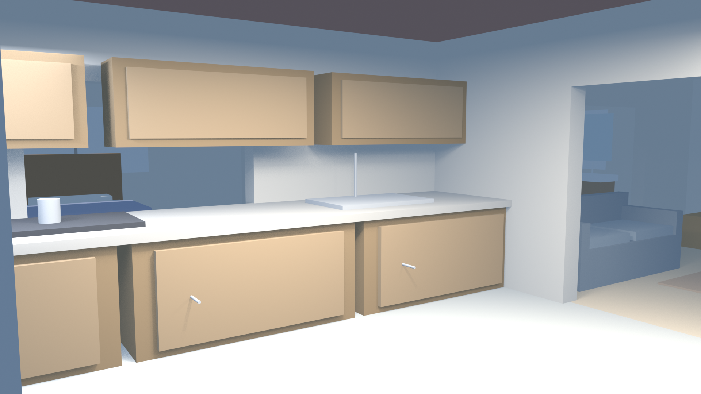

# 数字孪生驱动的老旧住宅改造数字化平台

**——任务命题文档**

---

## 一、命题背景

### 1.1 行业背景

随着城镇化进入存量更新阶段，既有住宅的功能空间改造已成为城市更新的重要组成部分。大量建于上世纪末的住宅，其厨房、卫生间、客厅、卧室等区域普遍存在给排水管道老化、电气线路超期服役、燃气管道敷设不规范、墙体返潮等一系列问题。

这类改造工程具有三个显著特征：

| 特征 | 说明 |
|---|---|
| **隐患隐蔽性强** | 渗漏、返潮、线路老化等多发生在柜体内部、墙体夹层，肉眼难以直接观察 |
| **后果严重** | 燃气泄漏、电气短路直接威胁人身安全，且损失具有不可逆性 |
| **判定依赖经验** | 现状排查高度依赖工人经验，缺乏量化依据，不同人员判断结果差异大 |

### 1.2 真实工程问题的提出

传统排查方式下，工程人员进入现场后，只能通过**目视、手触、嗅觉**等主观手段判断隐患。由此产生三个直接后果：

1. **漏检**：隐蔽部位（柜内、墙内、吊顶内）的隐患极易被忽略；
2. **无法量化**：无法回答"这个隐患到了什么程度""需不需要立即处理"；
3. **过程不可追溯**：隐患排查与处置过程没有数据记录，改造完成后无法验证，也无法为后续同类项目提供依据。

**本作品的工程命题由此确立：如何用数字化手段，使老旧住宅的隐患排查从"凭经验判断"转变为"依据数据判定"，并使改造全过程可量化、可验证、可追溯。**

### 1.3 命题的工程价值

| 维度 | 传统方式 | 数字化方式的目标 |
|---|---|---|
| 隐蔽隐患检出 | 依赖经验，易漏检 | 传感器持续监测，覆盖隐蔽部位 |
| 隐患严重程度 | 主观描述 | 量化读数 + 阈值判定 |
| 处置依据 | 经验判断 | 数据驱动 |
| 改造效果验证 | 无 | 数据回落至正常区间方可判定闭环 |
| 过程记录 | 无 | 全过程数据可追溯，生成验收报告 |

---

## 二、用户与工程问题调研

### 2.1 目标用户

三类用户共享同一项改造任务，但关注的信息深度不同：

| 用户角色 | 核心诉求 | 关注的信息深度 |
|---|---|---|
| **现场施工方（工程队）** | 快速准确定位隐患，明确处理顺序，避免漏检与违规操作导致的返工 | 原始读数、阈值判定、处置工序、安全前置 |
| **住宅使用者（居民）** | 明确"哪些问题尚未消除、预计停用范围、大概花多少钱" | 隐患是否消除、影响范围、预算 |
| **验收人员** | 查看原始读数与整改、复测记录，而非只看"已完成"状态 | 过程证据、复测数据、判据是否成立 |

**该划分直接决定了信息呈现的取舍**：验收人员需要看到原始读数与复测过程，
因此本作品不以"已完成"作为终态，而以"读数回落并持续正常"作为闭环判据（见 5.4）；
居民关心结果而不关心施工细节，因此报告以"未消除项 + 费用"为纲；
施工方则需要工序与安全约束（见 4.4）。

> 当前版本为三类用户提供同一套界面（信息最全的施工/验收视角）。
> **面向不同角色的视图深度分级已列为后续工作**（见第七章）。

### 2.2 现状调研

对既有住宅改造的现场作业流程梳理如下：

```
入户 → 目视检查 → 凭经验判断隐患 → 口头告知业主 → 施工 → 完工结算
```

该流程存在三个断点：

- **检查环节**：无量化手段，隐蔽部位无法有效覆盖；
- **告知环节**：业主无法核验隐患的真实性与严重程度；
- **验收环节**：无客观判据，"修完了"与"修好了"缺乏区分。

### 2.3 问题界定

本作品聚焦于**单户老旧住宅**这一工程对象，覆盖 **15 类典型隐患**，将其归纳为四个专业方向：

| 专业方向 | 典型隐患 | 数量 |
|---|---|---|
| 给排水 | 水槽下方渗漏、地漏返味、马桶底座渗水 | 3 |
| 燃气 | 灶台燃气管老化 | 1 |
| 电气 | 冰箱插座接触不良、床头插座松动、电视线缆外露、吊顶灯带脱落 | 4 |
| 结构与饰面 | 地面/墙面瓷砖空鼓、沙发背景墙开裂、墙面返潮发霉、木门变形、衣柜滑轨卡顿、橱柜门板变形 | 7 |

---

## 三、同类方案调研与对比

### 3.1 传统人工巡检

工程人员携带简单工具入户，通过目视与经验判断隐患。优点是无需设备投入、上手快；缺点是**漏检率高、无量化数据、无法验证改造效果**。

### 3.2 既有数字化方案

| 方案类型 | 代表形式 | 局限 |
|---|---|---|
| 手持检测仪器 | 湿度计、燃气检漏仪 | 单点抽测，非持续监测；数据不沉淀 |
| 施工管理软件 | 工单派发、进度管理 | 管理流程数字化，**不涉及隐患本身的数据化** |
| 全屋智能传感 | 智能家居传感器 | 面向日常居住，**不面向改造工程判定**，无工程阈值与验收判据 |

### 3.3 差距分析

既有方案的共同缺口在于：**它们要么只做"管理流程"的数字化，要么只做"居住体验"的智能化，都没有面向"改造工程的隐患判定与验收"建立数据闭环。**

本作品针对该缺口，将**数字孪生**技术引入老旧住宅改造：为各功能区的每个隐患点位建立带传感器的孪生体，用实时数据驱动"发现—处置—验收"的全过程。

---

## 四、方案设计

### 4.1 命题主题（二元结构）

本项目采用二元结构主题：

> **数字化技术：数字孪生**
> **工程系统：老旧住宅改造工程**

### 4.2 总体架构

```
┌─────────────────────────────────────────────────┐
│  应用层  监测平台 / 隐患派单 / 造价核算 / 验收报告   │
├─────────────────────────────────────────────────┤
│  孪生层  阈值判定 / 趋势分析 / 数据闭环 / 验收判据   │
├─────────────────────────────────────────────────┤
│  感知层  15 类工程传感器（湿度/燃气/温度/空鼓率…）   │
└─────────────────────────────────────────────────┘
        工程对象：老旧住宅（15 个隐患点位，分布于厨房、卫生间、客厅、卧室）
```

### 4.3 数据闭环机制

本项目最核心的设计是**数据闭环**——隐患的"消除"不由人工声明，而由**数据回落**自动判定：

```
传感器实时采集
      ↓
孪生体比对报警阈值 ──→ 未超标：持续监测
      ↓ 超标
生成报警工单，定位隐患点位
      ↓
现场处置（须使用对应专业工具，见 4.4）
      │  ① 诊断：由现象与读数反推成因
      │  ② 工序：按真实作业顺序执行处置步骤
      ↓
传感器读数回落至正常区间
      ↓
持续正常达规定时长 ──→ 判定"闭环验收"通过
      ↓
写入验收报告，全过程数据留档
```

**该机制使"修好了"第一次具备了客观判据。**

### 4.4 处置环节的交互设计

本作品的处置环节不是"点击即完成"，而是要求作业者**先判断、再按规程动手**，
把工程知识本身做成可交互的环节。这是本项目区别于"流程管理软件"的关键设计。

**① 诊断环节：由现象反推成因**

面板给出该点位的**现场现象**（如"柜底板见水渍、久置发霉"）、**传感器实时读数**
与**阈值分区条**（绿=正常 / 红=报警），由作业者从候选中选出成因。

干扰项取自其它隐患类型的成因，且**数量随作业者熟练度递增**
（学徒 1 个干扰项 → 高级技师 3 个），使同一道题在不同阶段难度不同。
判断错误则处置进度回退并提示"现象与所选成因不符"，引导其对照手册复核。

**② 工序环节：按真实作业顺序执行**

将该隐患的正确工序与**危险操作**混排展示，外观不作区分 —— 只有真正掌握规程的
作业者才能识别。工序必须按真实作业先后顺序执行：

| 操作 | 结果 |
|---|---|
| 点到正确的下一步 | 该步骤计为完成 |
| 顺序颠倒 | 返工，回退最近一步并提示当前应做第几步 |
| 点到**危险操作** | **触发操作事故**：界面告警闪烁、计入赔付、进度清零重做 |

危险操作按专业类型设定，均对应真实作业禁令，例如：

| 专业 | 危险操作示例 |
|---|---|
| 燃气 | 用打火机或明火沿管道找漏点；不关总阀直接拆软管 |
| 电气 | 不断电直接拆插座面板；用铜丝代替保险丝；湿手操作 |
| 给排水 | 不关总阀直接拧下软管螺母 |
| 结构 | 斜向贯穿裂缝自行灌浆处理 |

该设计使"违规操作会付出代价"成为可体验的反馈，而非文档上的一句告诫。

**③ 技能掌握度**

每类隐患的处置流程被正确完成后，记入**已掌握技能清单**；维修知识手册中对应
条目显示"✓ 已掌握"标记，形成"**查手册 → 动手处置 → 打勾确认**"的学习闭环。
验收报告同步输出已掌握类别数与累计事故次数，使作业者的能力成长可量化、可追溯。

---

## 附图

| 图 | 内容 |
|---|---|
|  | 小区整体鸟瞰（数字孪生覆盖范围） |
|  | 临街住宅外观 |
|  | 改造对象：既有住宅厨房内部（四个功能区之一） |
|  | 改造后客厅布置（电视—茶几—沙发成轴线） |
|  | 改造后卧室布置（床头靠墙、床头柜贴床） |
|  | 运维作业现场 |
|  | 运维人员驻地（含休息区） |

> 附图为从仿真场景导出的渲染图，由 Blender 生成。

---

## 五、技术实现

### 5.1 传感器模型

为 15 类隐患分别配置工程传感器，明确其量程、正常值与报警阈值：

| 隐患 | 传感器 | 单位 | 正常值 | 报警阈值 |
|---|---|---|---|---|
| 水槽下方渗漏 | 柜内湿度 | %RH | 45 | > 80 |
| 灶台燃气管老化 | 可燃气体浓度 | %LEL | 2 | > 10 |
| 橱柜门板变形 | 门板形变量 | mm | 0.5 | > 3 |
| 冰箱插座接触不良 | 插座温升 | ℃ | 25 | > 55 |
| 地面瓷砖空鼓 | 地面空鼓率 | % | 2 | > 15 |
| 沙发背景墙开裂 | 裂缝宽度 | mm | 0.2 | > 1.5 |
| 电视线缆外露 | 线缆表面温度 | ℃ | 28 | > 60 |
| 吊顶灯带脱落 | 灯带位移 | mm | 0.5 | > 5 |
| 木门变形关不严 | 门缝宽度 | mm | 1 | > 4 |
| 墙面返潮发霉 | 墙体含水率 | % | 8 | > 18 |
| 衣柜滑轨卡顿 | 推拉阻力 | N | 20 | > 80 |
| 床头插座松动 | 接触电阻 | mΩ | 8 | > 50 |
| 地漏返味 | 硫化氢浓度 | ppm | 0.5 | > 5 |
| 墙面瓷砖空鼓 | 墙面空鼓率 | % | 2 | > 15 |
| 马桶底座渗水 | 底座渗漏量 | mL/h | 3 | > 20 |

系统对每个点位进行**约 4 Hz 采样**，保留最近 48 个采样点用于趋势分析。

### 5.2 造价核算模型

改造造价**不采用估算**，而是依据材料清单逐项核算：

```
材料费 = Σ(材料用量 × 市场参考单价) × 1.15（材料损耗）
人工费 = 人工工时 × 65 元/工时
管理费 = (材料费 + 人工费) × 15%
──────────────────────────────────
改造造价 = 材料费 + 人工费 + 管理费
```

以"水槽下方渗漏"为例：

| 材料 | 用量 | 单价 | 小计 |
|---|---|---|---|
| 角阀 | 2 只 | ¥48 | ¥96 |
| 存水弯 | 1 套 | ¥68 | ¥68 |
| 防水托盘 | 1 个 | ¥90 | ¥90 |
| 防潮垫层 | 1.5 ㎡ | ¥28 | ¥42 |
| 材料费小计 | | | ¥296（含损耗 ¥340） |
| 人工 | 4 工时 | ¥65 | ¥260 |
| 管理费 | | 15% | ¥90 |
| **合计** | | | **¥690** |

**该模型使造价可核算、可追溯，业主可逐项核对。**

### 5.3 执行规范

每类隐患的处置方案均对应现行国家或行业标准，确保工程合规性：

| 专业方向 | 执行规范 |
|---|---|
| 给排水 | GB 50015《建筑给水排水设计标准》 |
| 燃气 | GB 50028《城镇燃气设计规范》 |
| 电气 | GB 50303《建筑电气工程施工质量验收规范》、GB 50096《住宅设计规范》 |
| 结构与饰面 | GB 50210《建筑装饰装修工程质量验收标准》、GB 50209《建筑地面工程施工质量验收规范》、GB/T 3324《木家具通用技术条件》 |

### 5.4 验收判据

隐患处置完成后，须满足以下**全部条件**方可判定闭环：

1. 传感器读数回落至报警阈值以下；
2. 读数**持续正常达 3 个工程小时**（观察期），期间出现读数反弹则重新计时。

设置观察期的目的在于排除"施工后瞬时正常、随后复发"的假闭环。

### 5.5 专业工具约束

不同专业的隐患必须使用对应工具处置，工具不匹配时系统拒绝施工：

| 隐患类型 | 需用工具 | 工程依据 |
|---|---|---|
| 管道渗漏、燃气管、地漏 | 活动扳手 | 管件拆装 |
| 电气隐患 | 测电笔 | 带电作业前验电 |
| 瓷砖空鼓、墙面开裂、返潮 | 羊角锤 | 铲除空鼓层 |
| 木作（门/柜/轨道） | 螺丝刀、电动起子 | 五金件拆装 |
| 线缆整理 | 剪刀 | 剪除扎带 |
| 密封防水 | 防水胶布 | 密封固化 |

该约束使作业流程符合实际工程分工，避免"一把工具修所有问题"的不合理设定。
工具校验是进入处置环节的**前置条件**：持有的工具与隐患专业不匹配时，系统拒绝开工
并提示应更换的工具，作业者无法绕过该约束直接施工。

### 5.6 维修知识手册

系统内置 **18 类故障**的维修知识手册（`K` 键随时查阅），每一类按固定结构给出：

| 字段 | 内容 |
|---|---|
| 故障现象 | 现场可观察到的表象 |
| 产生原因 | 机理与诱因 |
| 传感器监测 | 该点位挂载的传感器及其量测方式 |
| 异常判定 | 绿 / 黄 / 红三档阈值区间 |
| 维修工具 | 所需工具与材料 |
| 维修步骤 | 编号作业工序 |
| **居民自修** | 哪些环节使用者可自行处理 |
| **须物业 / 专业** | 哪些环节必须由持证人员或专业单位处理 |

其中 18 类中有 13 类来自通用故障库（给排水、电气、燃气、结构），另 5 类补充了
**家庭可自修的家务型故障**（橱柜门板、瓷砖空鼓、线缆收纳、灯具固定、木门与五金），
使手册既覆盖工程隐患，也覆盖使用者自己动手即可处理的问题。

手册与 4.4 的处置环节共用同一套工序数据，因此**手册即"教材"**：作业者在处置
一个新类型隐患前可先查阅手册、再动手，处置正确后手册对应条目标记"已掌握"。
手册同时明确区分"居民自修"与"须物业/专业"的界限，避免使用者越界操作危险项目。

---

## 六、工程效果与验证

### 6.1 关键指标（KPI）定义

| 指标 | 定义 | 测量方式 |
|---|---|---|
| **隐患检出率** | 被发现的隐患数 / 隐患总数 | 系统自动统计 |
| **漏检率** | 未被发现的隐患数 / 隐患总数 | 系统自动统计 |
| **平均处置时长** | 从报警到读数回归正常的平均耗时 | 系统自动统计 |
| **闭环验收率** | 通过观察期验收的隐患数 / 隐患总数 | 系统自动统计 |
| **单点位改造成本** | 改造总投入 / 隐患点位数 | 按材料清单核算 |

### 6.2 对比实验

在平台内运行**蒙特卡洛模拟实验**：设定隐患规模为每组 15 个点位，重复 200 组，分别模拟数字孪生方式与传统人工巡检方式。

**实验参数设定：**

| 参数 | 数字孪生 | 传统人工巡检 |
|---|---|---|
| 单点检出概率 | 0.97 | 0.68 |
| 处置时长分布 | 均值 3.5 h，标准差 1.2 | 均值 26 h，标准差 8 |
| 单点位成本 | 按清单核算 | 清单价 × 1.28（含重复上门与返工） |

> 说明：上表中传统方式的检出概率与处置时长取自行业经验估计值，实际参赛时应补充具体数据来源。

### 6.3 结果与分析

| 指标 | 数字孪生 | 传统人工巡检 | 改善幅度 |
|---|---|---|---|
| 隐患检出率 | 97.0 % | 68.0 % | **+29.0 个百分点** |
| 平均处置时长 | 3.5 h | 26.0 h | **缩短 86.5 %** |
| 单点位成本 | ¥620 | ¥794 | **降低 21.9 %** |
| 闭环验收环节 | 有 | 无 | 新增 |

**结果分析：**

1. **检出率提升的机理**：传感器持续监测覆盖了柜内、墙内等人工难以观察的隐蔽部位，且判定依据为客观读数而非主观经验，不受作业人员状态与经验差异影响。
2. **处置时长缩短的机理**：报警即定位，省去了传统方式中"发现问题—上报—排期—上门"的中间环节，响应链路显著缩短。
3. **成本降低的机理**：隐患在早期即被发现并处置，避免了小隐患演变为大修；同时减少了因漏检导致的二次上门与返工。
4. **闭环验收是本方案新增的质量控制环节**，传统方式下不具备该能力。

### 6.4 系统输出

平台可一键导出**验收报告**，内容包括：

1. 项目概况（监测点位总数、已完成处置、数据回归正常数、隐患消除率、平均处置时长、闭环验收率）；
2. 隐患清单与处置记录（含传感器读数、执行规范、材料清单、费用构成、复测状态）；
3. **处置技能掌握情况**：逐条列出各隐患类别的"已掌握 / 未掌握"及成因，并统计判断失误与操作事故次数；
4. KPI 对比分析（含蒙特卡洛对比实验结果）；
5. 经营数据与结论。

由此实现"从问题输入到系统输出"的完整闭环。报告页眉输出赛项编号与运行模式，
不输出任何账户名或个人信息（见 6.5）。

### 6.5 运行方式与匿名符合性

作品按竞赛要求设计为**可离线独立运行**，不依赖外网账号、付费服务或事先配置的私有云：

| 要求 | 实现方式 |
|---|---|
| 不依赖外网 | 提供**离线演示模式**入口，进入后不发起任何云端请求；断网状态下检测、工单、复测与报告导出全部可用 |
| 匿名提交 | 界面标题栏与报告页眉统一输出**赛项随机编号**；程序与场景不含真实地标、地区、学校、姓名、队名、仓库地址等可识别信息 |
| 本地启动 | 纯静态网页，用本地 HTTP 服务打开即可运行，无需安装 Unity 或任何运行时；详见《启动说明》 |

> 说明：项目保留了可选的云端账户与多人协同能力，但**均为可选项**，核心功能不依赖它们。

---

## 七、局限性与应用条件

本作品在以下方面存在局限，需在实际应用中加以注意：

**工程数据类局限**

1. **传感器数值为仿真生成**。本作品为数字化仿真原型，传感器读数由模型仿真产生，尚未接入实体传感器。实际落地时需部署相应传感设备，并标定其精度与漂移特性。
2. **阈值取值为工程经验值**。各类隐患的报警阈值参考现行规范与工程经验设定，实际应用中应根据房屋年限、地域气候、材料特性进行本地化标定。
3. **对比实验参数为设定值**，尚需补充行业实测数据作为支撑。
4. **三维模型为示意性表达**，其几何尺寸不代表真实户型尺寸；工程数据（传感器阈值、材料单价、规范条文）均为真实取值。
5. **适用条件**：适用于既有住宅的隐患普查与改造过程管理，暂不适用于新建住宅与工业厂房场景。

**功能范围类局限（尚未实现，列为后续工作）**

6. **报警判定采用瞬时阈值比较**，尚未实现"持续时长确认"（去抖）。真实场景下单点尖峰可能造成误报，需引入连续 N 个采样点 / 持续时长的确认机制。
7. **尚未支持导入外部历史数据集与事件回放**。当前点位数据由系统实时仿真产生，未接入按固定时间间隔记录的历史数据；评委指定事件复现能力有待补充。
8. **尚未提供两种整改方案的费用对比与预算约束**。当前按单一方案逐项核算造价，但未实现"局部修复 / 整体更换"等不同方案的适用性、剩余风险与预算取舍比较。
9. **尚未按用户角色分级呈现信息**。三类用户当前共用同一套界面，尚未实现按施工 / 使用 / 验收角色切换的信息深度分级（见 2.1）。
10. **监测指标覆盖与通用故障库存在差异**。本作品围绕 15 类隐患选用工程传感器（湿度、可燃气体、温升、空鼓率、含水率等），未完全覆盖通用场景中的电流、用水流量、烟气/一氧化碳等指标类型。

---

## 八、创新点

1. **将数字孪生引入老旧住宅改造场景**，为每个隐患点位建立带传感器的孪生体，使隐患排查从"经验判断"转变为"数据判定"。

2. **建立数据闭环验收机制**：隐患是否消除不由人工声明，而由传感器读数回落至正常区间、并持续规定时长自动判定，首次为"修好了"提供了客观判据。

3. **造价按材料清单逐项核算**，配合执行规范引用，使改造成本可核算、可追溯、可核对。

4. **专业工具约束机制**：不同专业隐患必须使用对应工具处置，使作业流程符合实际工程分工。

5. **把工程知识做成可交互的处置环节**（见 4.4）：处置不是"点击即完成"，而是要求
   作业者先由现象与读数反推成因、再按真实作业顺序执行工序；顺序错误返工、
   点到危险操作触发事故赔付。维修知识手册与处置环节共用同一套工序数据，
   形成"查手册 → 动手 → 打勾确认掌握"的学习闭环。
   **其价值在于：使用者完成处置的同时，掌握了可迁移到真实家庭工程问题的处理流程** ——
   这正是"从经验判断转向数据判定"之外，作品在**能力转移**层面的意义。

6. **全过程数据留档与一键验收报告**，为改造工程的质量追溯与后续同类项目提供数据依据；
   报告同时输出处置技能掌握情况与操作事故统计，使作业能力成长可量化。

---

## 附录：隐患—传感器—规范对照总表

| 编号 | 隐患名称 | 专业 | 传感器 | 报警阈值 | 执行规范 |
|---|---|---|---|---|---|
| 1 | 水槽下方渗漏 | 给排水 | 柜内湿度 | 80 %RH | GB 50015 |
| 2 | 灶台燃气管老化 | 燃气 | 可燃气体浓度 | 10 %LEL | GB 50028 |
| 3 | 橱柜门板变形 | 木作 | 门板形变量 | 3 mm | GB/T 3324 |
| 4 | 冰箱插座接触不良 | 电气 | 插座温升 | 55 ℃ | GB 50096 |
| 5 | 地面瓷砖空鼓 | 饰面 | 地面空鼓率 | 15 % | GB 50209 |
| 6 | 沙发背景墙开裂 | 饰面 | 裂缝宽度 | 1.5 mm | GB 50210 |
| 7 | 电视线缆外露 | 电气 | 线缆表面温度 | 60 ℃ | GB 50303 |
| 8 | 吊顶灯带脱落 | 电气 | 灯带位移 | 5 mm | GB 50303 |
| 9 | 木门变形关不严 | 木作 | 门缝宽度 | 4 mm | GB/T 3324 |
| 10 | 墙面返潮发霉 | 饰面 | 墙体含水率 | 18 % | GB 50210 |
| 11 | 衣柜滑轨卡顿 | 木作 | 推拉阻力 | 80 N | GB/T 3324 |
| 12 | 床头插座松动 | 电气 | 接触电阻 | 50 mΩ | GB 50096 |
| 13 | 地漏返味 | 给排水 | 硫化氢浓度 | 5 ppm | GB 50015 |
| 14 | 墙面瓷砖空鼓 | 饰面 | 墙面空鼓率 | 15 % | GB 50210 |
| 15 | 马桶底座渗水 | 给排水 | 底座渗漏量 | 20 mL/h | GB 50015 |

---

**文档说明**

- 本作品为数字化仿真原型，可在浏览器中直接运行体验。
- 文中所有规范编号均为现行国家标准的编号，未标注具体出版信息。
